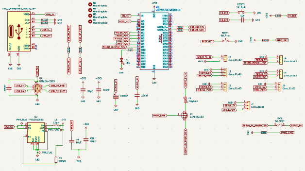
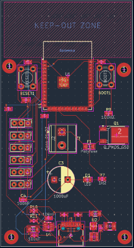
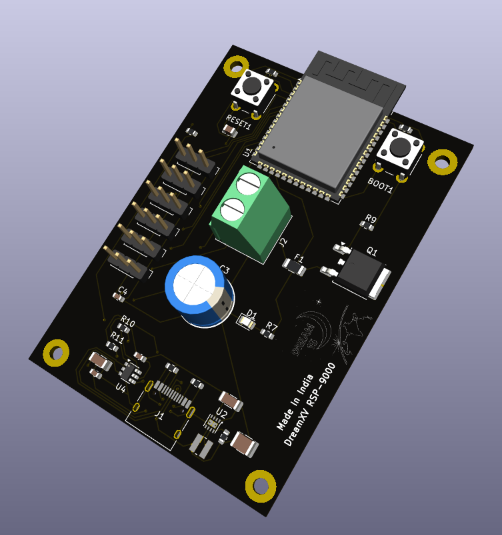
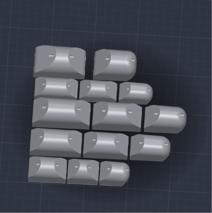
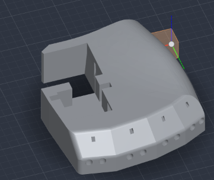
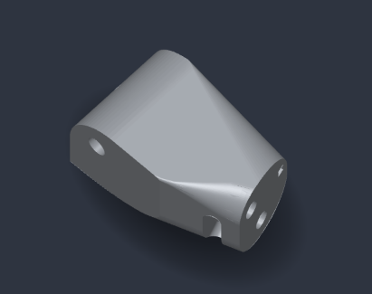
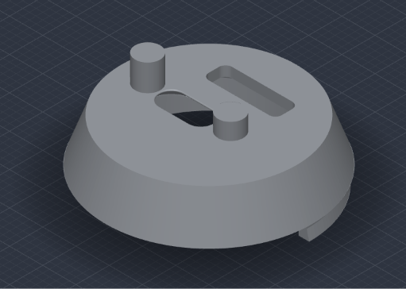
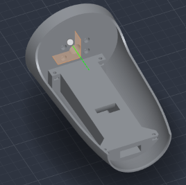
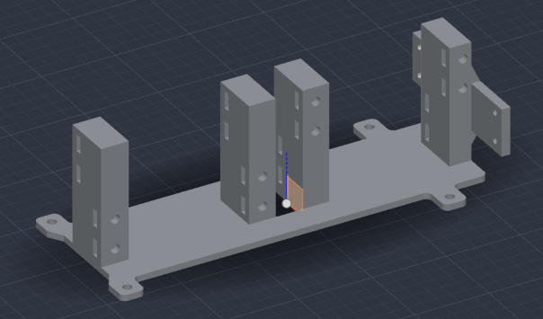

# 
RSP-9000 #
## 
Robotic Hand To Play Rock, Paper, Scissors ##
### 
Made by me - Tung Tung Tung Sahir ###
---
# 
--- What Is It And How It Works --- #

I have made this project for maker faire in china for #fallen

It is a Robotic Hand that can play Rock, Paper, Scissors with you, Cause you don't have friends lol :( 

It uses 4 MG996r Servo motors for four fingers and uses MG90s Servo for the movement of thumb
 

 I have also built a custom pcb but i won't get it on time so i will be using Arduino Board and PWM I2C for servos movement

I have also custom built the whole model for the hand with arm where holder is there to hold servo motors and also made custom horns for MG996r servo motors 

It works like you would press a button and on count of three the machine will select its move and move servo accordingly to the move and if you lose it celebrates and if you winn it flips you off

---

# 
--- Custom PCB --- #
### 
--- (not used cause i won't recive before event) --- ###
### Made by Me ###

Custom Schematic It uses ESP-32 S3 Wroom 1 Module with custom made servo pwm 

 

---

# 
--- Custom CAD --- #
### Made by Me ###

I have made custom CAD design for the hand with CAD's of Fingers, Palm, Thumb Joint, Wrist, Forearm, Servo Holder and Servo horn 

Here are the images 

---

---

# 
--- Custom Firmware --- #
### Made by Me ###

 For now i have made a simple custom firmware which only shows the movement of all servo after making the real build i will test and write real firmware 

